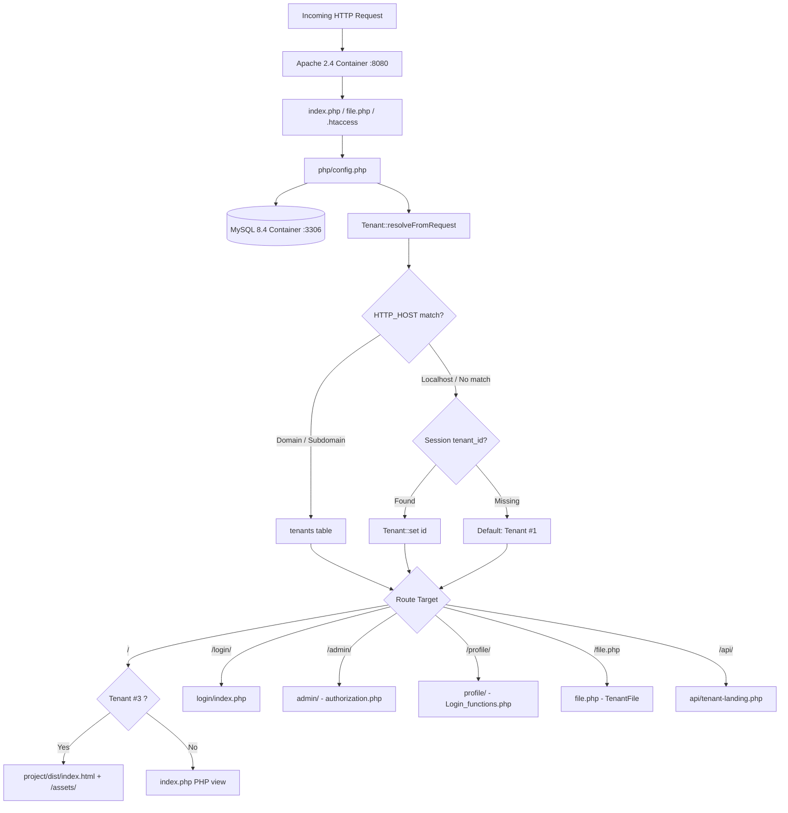
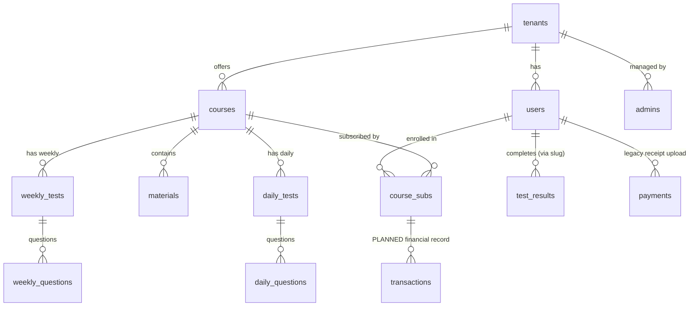
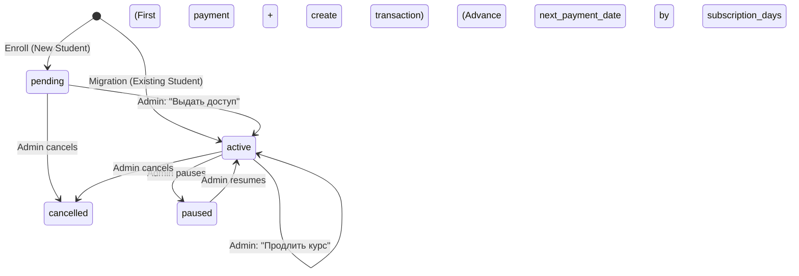

# e-Lesson — Multi-Tenant LMS & SaaS Platform

> **Authoritative Project Documentation**  
> *Last updated: September 2026*  
> *Target audience: Development Team, System Architects, AI Agents (Claude / Antigravity / Gemini)*

---

## 1. Product Overview

**e-Lesson** is a multi-tenant Learning Management System (LMS) and SaaS platform designed for private education centers, tutoring academies, and exam preparation centers in Uzbekistan (Tashkent and regional hubs).

### Problem Statement
Private education centers (teaching mathematics, physics, English/IELTS, science, and presidential school prep) typically run their operations across disconnected spreadsheets, Telegram channels, paper receipts, and unorganized video links. They lack an affordable, localized, white-label platform that unifies student enrollment, curriculum delivery, testing, payments, and branding.

### Solution & Value Proposition
e-Lesson provides education centers with an all-in-one branded platform:
- **Branded Web Presence:** Independent public landing pages with custom branding (colors, logo, contacts) and active course catalogs.
- **Student Learning Cabinet:** Web-based student dashboard for viewing lessons (video and PDF documents), tracking course progress, solving tests, and submitting payment receipts.
- **Education Center Admin Panel:** Comprehensive management of students, course curricula, video/PDF materials, tests, and payment verification.
- **Multi-Tenant SaaS Engine:** A single unified codebase and database hosting multiple education centers with strict row-level and filesystem data isolation.

---

## 2. Current Status & Status Definitions

Throughout this documentation, system components and features are categorized into three explicit states:
- `CURRENT`: Actually implemented and operational in the live codebase / database.
- `DECIDED`: Business / product rule agreed upon by the product architect, ready for implementation.
- `PLANNED`: Architectural roadmap item, not yet implemented in code or database logic.

| Component | Status | Description |
|---|---|---|
| **Multi-Tenancy** | `CURRENT` | Fully operational. Host-based resolution, session fallback, strict tenant scoping across queries. |
| **Authentication & RBAC** | `CURRENT` | Session-based auth with secure cookies, password hashing (`bcrypt`), CSRF protection, admin vs student separation. |
| **File Storage & Security** | `CURRENT` | Tenant storage (`storage/tenants/{id}/`), authorized delivery via `/file.php`, HTTP 206 partial content streaming. |
| **Student Cabinet** | `CURRENT` | Courses view, modern video/PDF player (`preload="metadata"`), test solver with timer, payment history, settings. |
| **Admin Panel** | `CURRENT` | Dashboard, students management, course & lesson CRUD, inline previews, test authoring, payment approvals. |
| **Public Landing** | `CURRENT` | Hybrid: Modern React/Vite landing for Demo Academy (`Tenant #3`), classic multi-language landing for Tenant #1. |
| **Automated Testing** | `CURRENT` | Playwright test suite in `e2e/` (verified: 43/43 `phase3g` regression, 7/7 `student_functional_fixes`). |
| **Legacy Receipts Payment** | `CURRENT` | Student uploads receipt image in `/profile/payments.php`; admin accepts/rejects in `/admin/payments/view.php`. |
| **Flat Transactions Model** | `DECIDED / PLANNED` | Schema (`transactions`, `course_subs` status/next_payment_date) exists in MySQL; application logic pending implementation. |

---

## 3. Architecture

### Technology Stack
- **Backend:** PHP 8.2+ (running on Apache 2.4 prefork inside Docker)
- **Database:** MySQL 8.4 LTS (`utf8mb4_unicode_ci`, PDO with parameter binding)
- **Frontend (Application):** Server-rendered PHP views + Tailwind CSS + Lucide Icons + vanilla JS
- **Frontend (Marketing Landing):** React 18 + TypeScript + Vite + Tailwind CSS (located in `project/`)
- **Infrastructure:** Docker Compose (services: `web` on port 8080, `db` on port 3307)
- **Testing:** Playwright (`@playwright/test`) running in Chromium headless shell

### Request Flow


### Component Roles
1. **`php/config.php`:** Central bootstrap. Connects PDO with `ERRMODE_EXCEPTION`, loads `php/tenant.php`, and invokes `Tenant::resolveFromRequest()`.
2. **`file.php`:** Single authorized streaming gateway for private assets (videos, PDFs, question images, receipts). Direct URL access to media folders is bypassed in favor of this access-controlled endpoint.
3. **`project/`:** Standalone Vite + React application for public marketing. Builds to `project/dist/` and synchronizes compiled bundles into root `/assets/` and `/favicon.svg`.
4. **`api/tenant-landing.php`:** Public JSON API providing tenant branding and active course listings to the React landing page.

---

## 4. Repository Structure

```text
e-Lesson/
├── .env                        # Local environment variables & secrets (NOT in VCS)
├── .env.example                # Template for environment configuration
├── .htaccess                   # Apache URL rewriting & sensitive file blocking
├── Dockerfile                  # PHP 8.2-apache container image definition
├── docker-compose.yml          # Multi-container orchestration (web + db services)
├── package.json                # Root package configuration (Playwright)
├── package-lock.json           # Root NPM lockfile
├── playwright.config.ts        # Playwright E2E testing configuration
├── file.php                    # Authorized streaming gateway for private files
├── index.php                   # Root application entry point & router
├── manifest.json               # PWA web app manifest
├── server-worker.js            # PWA Service Worker
├── favicon.svg                 # Site favicon
├── _test_create_session.php    # Test helper endpoint (used by Playwright)
│
├── admin/                      # Education Center Admin Panel
│   ├── authorization.php       # Admin session & CSRF verification middleware
│   ├── dashboard.php           # Admin overview metrics & quick links
│   ├── courses/                # Course creation, editing, analytics & lesson listing
│   ├── materials/              # Lesson video/PDF upload and management
│   ├── questions/              # Test question image uploads & answer keys
│   ├── tests/                  # Daily and weekly test management
│   ├── students/               # Student roster & student profile management
│   ├── payments/               # Payment approvals & receipt review
│   ├── settings/               # Center profile & branding settings
│   ├── super/                  # Super-admin portal (multi-tenant provisioning)
│   ├── includes/               # Admin header, sidebar (sidebar.php), footer, translations
│   ├── adminBooks/             # [Legacy Prototype] Library module (out of core MVP)
│   └── php/                    # Admin login/logout handlers
│
├── profile/                    # Student Cabinet
│   ├── index.php               # Student dashboard
│   ├── courses.php             # Enrolled & available courses catalog
│   ├── course.php              # Modern lesson player (video streaming, PDF, test list)
│   ├── tests.php               # Test catalog (daily & weekly tests)
│   ├── test.php                # Interactive test-taking engine (timer, scoring)
│   ├── payments.php            # Payment history & receipt upload modal
│   ├── settings.php            # Profile information & password change
│   └── includes/               # Student header, sidebar, topbar, mobilenav, footer
│
├── login/                      # Authentication Module
│   ├── index.php               # Unified student login page
│   ├── registration.php        # Student multi-step registration
│   ├── reset_password.php      # Password reset flow
│   └── Login_functions.php     # Session handling, slug generation, auth verification
│
├── course/                     # Legacy student course viewing routes
├── classes/                    # Legacy course & grade-level browsing
├── api/                        # Internal & public API endpoints
│   └── tenant-landing.php      # Public tenant branding & course API
├── php/                        # Core backend utilities
│   ├── config.php              # Database PDO bootstrap & tenant resolution
│   ├── tenant.php              # Tenant resolution class (Tenant)
│   ├── tenant_file.php         # Tenant file isolation helper (TenantFile)
│   └── PHPMailer/              # SMTP mailer library
│
├── database/                   # Database schemas and seeds
│   ├── schema.sql              # Base database schema
│   ├── seed.sql                # Seed data for Tenant #1
│   ├── seed_demo_academy.sql   # Seed data for Tenant #3 (Demo Academy)
│   └── migrations/             # Historical migration record — all 3 are already incorporated
│       │                       # into schema.sql's baseline (see status header in each file)
│       ├── 001_fix_users_optional_fields.sql
│       ├── 002_add_tenant_support.sql
│       └── 003_add_subscription_financial.sql
│
├── project/                    # Modern React/Vite Landing Page source
│   ├── src/                    # React components (App.tsx, Hero, Courses, etc.)
│   ├── dist/                   # Built production bundle (index.html)
│   └── package.json            # Vite build scripts & dependencies
│
├── assets/                     # Compiled production assets from project/ build
├── css/                        # Global application CSS (index.css, profile.css)
├── js/                         # JavaScript utilities and translations
│   └── lang/                   # i18n dictionaries (ru.json, uz.json, en.json)
├── img/                        # Core UI assets & images
├── images/                     # Marketing media assets
├── storage/                    # Active tenant file storage (courses/, receipts/, books/)
│   └── tenants/                # Subdivided by tenant_id (1, 2, 3)
├── uploads/                    # Legacy uploads directory (books/, tenants/)
├── course_resources/           # Legacy media assets (.htaccess protected)
├── other_resources/            # Additional legacy resources (.htaccess protected)
├── e2e/                        # Automated Playwright test suites (12 spec files)
└── _archive/                   # Archived historical prototypes, figma dumps & backups
```

---

## 5. Multi-Tenancy

e-Lesson implements **logical row-level multi-tenancy** backed by isolated storage directories.

### Tenant Resolution Order
`Tenant::resolveFromRequest()` in [`php/tenant.php`](php/tenant.php) resolves the active tenant in this strict order:
1. **Custom Domain:** Matches `tenants.domain = HTTP_HOST` (e.g., `academy.uz`).
2. **Subdomain:** Matches `{slug}.e-lesson.uz` against `tenants.slug`.
3. **Session Context:** If `localhost` or no domain match, checks `$_SESSION['tenant_id']` (or `$_SESSION['admin_tenant_id']`).
4. **Default Fallback:** Defaults to `tenant_id = 1` (`IQ-CREATIVE`).

### Verified Active Tenants
| Tenant ID | Name | Slug | Primary Domain / Host | Purpose |
|---|---|---|---|---|
| **1** | IQ-CREATIVE | `iq-creative` | `localhost:8080` (default) | Reference education center, math/science prep |
| **2** | Test Academy | `test-academy` | `test-academy.e-lesson.uz` | Automated testing tenant (used for IDOR verification) |
| **3** | Demo Academy | `demo-academy` | `demo-academy.e-lesson.uz` | Production demo tenant with modern React landing |

### Tenant Isolation Rules
- **Database Queries:** Application queries touching student, course, material, test, result, or payment data include `WHERE tenant_id = ?`. *(Note: Enforced in application code; MySQL database does not enforce foreign keys on `tenant_id`).*
- **Center Admin Constraint:** Center administrators can only view and mutate records belonging to their assigned `$_SESSION['admin_tenant_id']`.
- **Super Administrator:** Admin with `role = 'super_admin'` and `tenant_id = 0` can access `admin/super/` to provision and manage tenants.
- **Cross-Tenant IDOR Prevention:** Verified by automated E2E tests (`e2e/phase3g.spec.ts` Group 7).

---

## 6. Authentication & Authorization

### User Roles
1. **Student (`users` table):** Authenticates with email and password via `/login/`. Accesses `/profile/` and `/course/`.
2. **Center Admin (`admins` table, `role = 'center_admin'`):** Authenticates via `/admin/php/login.php`. Restricted to their assigned `tenant_id`. Accesses `/admin/`.
3. **Super Admin (`admins` table, `role = 'super_admin'`):** Unrestricted access across all tenant records. Accesses `/admin/super/`.

### Security Mechanisms
- **Password Hashing:** Passwords are encrypted using PHP `password_hash($password, PASSWORD_BCRYPT)`.
- **Session Security:** Cookie parameters configured with `lifetime = 7 days`, `httponly = true`, `samesite = 'Lax'`, and dynamic `secure = true` on HTTPS.
- **Session Desynchronization Guard:** Sessions explicitly bound to `tenant_id`. If an admin's tenant becomes inactive, the session is destroyed immediately.
- **CSRF Protection:** Admin forms and student test submissions use `csrfToken()` and `verify_csrf()` / `validateCsrfToken()` with constant-time `hash_equals()`.

---

## 7. Database

### Database Engine & Configuration
- **DBMS:** MySQL 8.4 LTS
- **Charset / Collation:** `utf8mb4` / `utf8mb4_unicode_ci`
- **Driver:** PHP Data Objects (PDO) with parameter binding.

### Schema Reproducibility
`database/schema.sql` is the reproducible baseline for a fresh install: applying it (plus `database/seed.sql`) to an empty MySQL volume reproduces the CURRENT schema the application actually depends on today. `database/migrations/` is a historical record of how the schema got there — `001`-`003` are marked in their own headers as already incorporated into `schema.sql`, so a fresh install does not need to run them. `004_fix_transactions_created_by.sql` records a corrective change applied directly to the project's running database (see below) rather than a fresh-install concern.

> [!CAUTION]
> `schema.sql` is not a live-sync mechanism. `CREATE TABLE IF NOT EXISTS` silently no-ops against a table that already exists — editing `schema.sql` never retroactively changes an already-running database. This project's own running/demo database predates the current `schema.sql` baseline; its one known divergence (`transactions.created_by`) was corrected directly on 2026-09-05 via `database/migrations/004_fix_transactions_created_by.sql`, so the repository and the live database no longer disagree on this point. Any future schema change intended for an existing environment still needs a real migration, not just a `schema.sql` edit.

### Key Tables & Entity Relationships



### Table Definitions & Actual Schema State

| Table | Purpose | Status | Primary Key | Key Fields & Actual Behavior |
|---|---|---|---|---|
| `tenants` | Multi-tenant registry | `CURRENT` | `tenant_id` | `name`, `slug` (UNIQUE), `domain`, `logo_path`, `primary_color`, `secondary_color`, `accent_color`, `is_active` |
| `users` | Student accounts | `CURRENT` | `user_id` | `first_name`, `last_name`, `email` (UNIQUE), `password`, `phone`, `class`, `points`, `slug` (UNIQUE), `tenant_id`, `balance` *(legacy)* |
| `admins` | Platform & center admins | `CURRENT` | `id` | `username` (UNIQUE), `role` (`'super_admin'`, `'center_admin'`), `password_hash`, `tenant_id` |
| `courses` | Educational courses | `CURRENT` | `course_id` | `title`, `subject`, `price` (UZS), `subscription_days` (default 30), `classLevel`, `is_active`, `tenant_id` |
| `course_subs` | Course subscriptions | `CURRENT` *(partial fields PLANNED)* | `subscription_id` | `user_id`, `course_id`, `price`, `purchase_date`, `access_expires_at`, `next_payment_date`, `status` (`'pending'`,`'active'`,`'paused'`,`'cancelled'`), `tenant_id`.<br>**Current code behavior:** Access is strictly checked via `access_expires_at > NOW()`. Columns `next_payment_date` and `status` are part of `schema.sql`'s baseline (originally added via migration `003_add_subscription_financial.sql`), but application lifecycle logic is `PLANNED`. |
| `materials` | Lessons within course | `CURRENT` | `material_id` | `course_id`, `title`, `description`, `file_path`, `thumbnail_path`, `duration`, `tenant_id` |
| `daily_tests` | Daily assessments | `CURRENT` | `daily_test_id` | `course_id`, `material_id`, `title`, `min_score`, `max_score`, `tenant_id` |
| `weekly_tests` | Milestone tests | `CURRENT` | `weekly_test_id` | `course_id`, `title`, `min_score`, `max_score`, `tenant_id` |
| `daily_questions` | Daily questions | `CURRENT` | `daily_question_id` | `daily_test_id`, `question_text`, `question_img_url`, `correct_answer` (`A`, `B`, `C`, `D`) |
| `weekly_questions`| Weekly questions | `CURRENT` | `weekly_question_id`| `weekly_test_id`, `question_text`, `question_img_url`, `correct_answer` (`A`, `B`, `C`, `D`) |
| `test_results` | Student test results | `CURRENT` | `result_id` | `slug` (links to `users.slug`), `test_id`, `test_type` (`daily`/`weekly`), `score`, `get_points`, `completed_at`, `tenant_id` |
| `payments` | Legacy receipts table | `CURRENT` | `payment_id` | `user_id`, `course_id`, `amount`, `payment_method`, `issued_by` (username string), `status` (`accepted`/`approved`/`pending`/`rejected`/`waiting_amount`/`amount_corrected`), `receipt_path`, `deleted_at`/`deleted_by`/`deletion_reason`/`access_revoked` (soft-delete & access-revocation), `tenant_id`.<br>**Current code behavior:** Active payment flow. Student uploads receipt image; admin verifies and extends `access_expires_at`; admin can also soft-delete an erroneous payment record. |
| `transactions` | Flat financial accounting | `PLANNED` *(Schema in DB, logic unlinked)* | `transaction_id` | `tenant_id`, `user_id`, `course_sub_id`, `amount`, `payment_date`, `payment_method` (`cash`/`card`/`transfer`), `receipt_path`, `notes`, `created_at`, `created_by` (the recording admin's username as a plain string, matching `payments.issued_by` — not a foreign key to `admins`, to avoid losing the audit trail if that admin account is later deleted).<br>**Current state:** Table exists in MySQL schema (0 rows); NO PHP code references or queries this table yet. |
| `books` | Library module | `CURRENT` *(Legacy)* | `book_id` | `title`, `book_path`, `preview_path`, `tenant_id`. Legacy prototype table. |
| `other_resources` | Additional files | `CURRENT` *(Legacy)* | `resource_id` | `title`, `resource_path`, `tenant_id`. Admin resources table. |

---

## 8. Admin Panel

Located at `/admin/`. Authenticated center administrators manage their education center.

### Navigation (`admin/includes/sidebar.php`)
The active admin sidebar contains:
1. **Dashboard (`/admin/dashboard.php`):** High-level KPIs (total students, active courses, pending payments, revenue summary).
2. **Students (`/admin/students/`):**
   - Search and filter students by grade and name.
   - Student Detail Profile (`view.php`):
     - View student info, grade, contact details.
     - View enrolled courses and score averages.
     - View test history.
     - Extend course access (`extend_course` action advances `access_expires_at`).
     - Verify or reject pending payment receipts.
3. **Courses (`/admin/courses/`):**
   - Course listings by grade and subject.
   - Course View (`view.php`):
     - Tabs: Overview, Content (Lessons/Materials), Students, Tests.
     - Lesson inline preview (HTML5 `<video preload="metadata">` and document viewer).
     - Add/Edit material modal with file upload.
4. **Books (`/admin/adminBooks/`):** *[Legacy Prototype]* Retained in sidebar template; outside intended MVP core.
5. **Payments (`/admin/payments/`):**
   - Filter legacy payments by period, course, class, and status.
   - Review student payment receipts via `/file.php?type=receipt&id=...`.
   - Accept payment (auto-extends `access_expires_at` by `courses.subscription_days`).
   - Reject payment with explanation comment.
6. **Settings (`/admin/settings/`):** Center name, contact details, branding colors.

---

## 9. Student Cabinet

Located at `/profile/`. Provides students with an interface for course learning and self-service.

### Key Pages & Actual Behavior
- **Dashboard (`/profile/index.php`):** Active courses carousel, upcoming tests, points leaderboard summary.
- **My Courses (`/profile/courses.php`):**
  - **CURRENT Behavior:** Grid of enrolled courses (queried via `JOIN course_subs`). Displays completion progress %, lesson counts, formatted access expiration date (`до DD.MM.YYYY`), and urgency badge (`Осталось X дн.`) when within 14 days of expiration based on `course_subs.access_expires_at`.
  - **PLANNED Behavior:** Transition from access expiration countdown to next payment schedule indicator, keeping active subscriptions accessible even when payment is overdue.
- **Course Player (`/profile/course.php`):**
  - Unified lesson player.
  - Native HTML5 `<video controls preload="metadata">` streaming via `/file.php?type=material&id=...#t=0.001`.
  - PDF document viewer for lecture notes and handouts.
  - Sidebar with lesson list and progress indicators.
  - Linked Daily and Weekly tests.
  - **Access Gate:** Checks `access_expires_at > NOW()`. *Ad-hoc free course bypass:* if `course.price == 0` and `course.classLevel == user.class`, access is permitted without an active subscription row.
- **Tests (`/profile/tests.php` & `test.php`):**
  - Lists daily tests attached to lessons and course-level weekly tests. (Requires `access_expires_at > NOW()`).
  - Test Solver (`test.php`): Countdown timer, image-based question cards, interactive option selectors, instant scoring, score/points recording.
- **Payments (`/profile/payments.php`):**
  - **CURRENT Behavior:** Displays course subscription status and days left based on `access_expires_at`. Modal allows uploading receipt image/PDF for a course. Displays review status (`Ожидает проверки`, `Подтверждено`, `Отклонено`).
  - **PLANNED Behavior:** Transition to clear payment schedule and history view without manual receipt upload requirement.
- **Settings (`/profile/settings.php`):** Update personal details, contact phone, and password.

### UI & Styling Guidelines
- Clean, compact, accessible UI with Tailwind CSS.
- Consistent terminology: **"Уроки"** (RU) / **"Darslar"** (UZ) / **"Lessons"** (EN). Do not use "Видеоуроки" or "Материалы".

---

## 10. Public Landing

e-Lesson features a modern hybrid public landing architecture:

```text
Request to /
  │
  ├── Tenant #3 (Demo Academy)
  │     └── Renders project/dist/index.html
  │           └── React 18 SPA (Vite + Tailwind)
  │                 └── Calls GET /api/tenant-landing.php
  │                       └── Dynamic branding: name, logo, colors, active courses
  │
  └── Tenant #1 (IQ-CREATIVE) & Fallbacks
        └── Renders index.php
              └── Native PHP + CSS template with 4-language switcher (UZ/RU/EN/FR)
```

### React Landing Build & Asset Synchronization
- Source code lives in `project/`.
- Build command:
  ```bash
  cd project && npm run build
  ```
  The build script automatically executes:
  `vite build && rm -rf ../assets && cp -r dist/assets ../assets && cp dist/favicon.svg ../favicon.svg`
- Compiled assets are served directly from the root `/assets/` directory.

---

## 11. Courses, Lessons & Tests

### Learning Hierarchy
```text
Course (Subject, Grade Level, Price, Subscription Days)
  ├── Lessons / Materials ("Уроки")
  │     ├── Video Lecture (.mp4, .mov) or PDF Handout
  │     ├── Lesson Description & Duration
  │     └── Daily Test (Optional, max 1 per lesson)
  │           └── Questions (Image-based + Multiple Choice)
  └── Weekly Tests (Course-level Milestone Assessments)
        └── Questions (Image-based + Multiple Choice)
```

### Access & Business Rules
1. **Course Access Inheritance:** Lessons and tests inherit access from the student's `course_subs` enrollment. Tests are **NOT** sold as separate products.
2. **Free Course Access:**
   - In CURRENT code (`profile/course.php` and `file.php`): if `courses.price == 0` and `courses.classLevel == users.class`, lesson viewing and file streaming are granted even without an active `course_subs` row.
   - However, free courses are not automatically auto-enrolled in `profile/courses.php` overview or `profile/tests.php` without an explicit `course_subs` enrollment record.
3. **Fresh Test Attempt Guarantee:** Opening a test for the first time must **NEVER** pre-complete the test, insert a `test_results` record, or award points. Results are generated only upon explicit POST submission.

---

## 12. Payments & Financial Model

> [!IMPORTANT]
> This section clearly separates the **CURRENT IMPLEMENTATION** from the **DECIDED / PLANNED ARCHITECTURAL MODEL**.

### Current Implementation (Legacy Receipt Workflow) — `CURRENT`
- Powered by the `payments` table and `course_subs.access_expires_at`.
- Student uploads receipt in `/profile/payments.php` -> row created with `status = 'pending'`.
- Admin reviews receipt at `/admin/payments/view.php` and clicks "Подтвердить" or "Отклонить".
- Approval extends access: `course_subs.access_expires_at = DATE_ADD(GREATEST(access_expires_at, NOW()), INTERVAL subscription_days DAY)`.
- Admin can also manually extend access in student profile (`extend_course`) without creating a payment record.
- Access check everywhere in code evaluates `access_expires_at > NOW()`. If expired, student access is blocked.

---

### Agreed Business Model (Flat Transactions & Non-Blocking Access) — `DECIDED / PLANNED`



#### Core Financial Principles
1. **Enrollment is NOT a payment:** Adding a student to a course creates `course_subs` with `status = 'pending'`. No transaction is created. Access is closed until first payment.
2. **First Payment ("Выдать доступ"):**
   - Admin action for students in `status = 'pending'`.
   - Admin inputs: `amount`, `payment_method` (`cash`/`card`/`transfer`), `payment_date`, `next_payment_date`, optional notes/receipt.
   - Updates `course_subs`: `status = 'active'`, `next_payment_date = selected_date`, `access_expires_at = selected_date`.
   - Creates a record in `transactions`.
   - *Rationale:* Education centers frequently operate on fixed calendar billing cycles (e.g. 1st of the month) with prorated initial payments.
3. **Subsequent Payments / Renewal ("Продлить курс"):**
   - Admin action for students in `status = 'active'`.
   - Creates a record in `transactions`.
   - Advances `next_payment_date` strictly from its **CURRENT planned date** by `+subscription_days` (NOT from today's date):
     `next_payment_date_new = next_payment_date_current + subscription_days`
   - Synchronizes `access_expires_at = next_payment_date`.
4. **Overdue Payments DO NOT Block Access (Non-Cutting Access):**
   - If `next_payment_date < CURDATE()`, student access remains active (`status = 'active'`).
   - Admin sees overdue badge and days overdue in payment reporting.
   - Student sees a reminder notice, but lessons and tests remain accessible.
   - When overdue payment is received, `next_payment_date` still advances from the scheduled date, preserving the billing cycle.
5. **Existing / Migrated Students:**
   - Enrolled with `status = 'active'`, `next_payment_date` set to their existing schedule.
   - No historical transaction created.
6. **Revenue Calculation:**
   `Revenue = SUM(transactions.amount) WHERE tenant_id = ? AND payment_date BETWEEN [start, end]`
7. **Explicit Non-Requirements (Out of MVP Scope):**
   - ❌ NO double-entry bookkeeping or general debt ledgers.
   - ❌ NO student wallet balances or negative balances for billing.
   - ❌ NO automated recurring billing engines.
   - ❌ NO online payment gateway integration (Payme/Click) in MVP.
   - ❌ NO automatic access cut-off upon overdue date for active students.

---

## 13. File Storage & Security

### Actual Storage Directories on Disk
Files are segregated between active tenant-isolated storage and legacy directories:

```text
storage/
└── tenants/
    ├── 1/                     # Active Tenant #1 (IQ-CREATIVE)
    │   ├── books/
    │   ├── courses/           # courses/{course_id}/
    │   ├── logo/
    │   ├── receipts/          # Student payment receipts
    │   └── resources/
    ├── 2/                     # Active Tenant #2 (Test Academy)
    └── 3/                     # Active Tenant #3 (Demo Academy)

uploads/                       # Legacy uploads (books/, tenants/)
course_resources/              # Legacy course media (.htaccess "Deny from all")
other_resources/               # Legacy resources (.htaccess "Deny from all")
```

### Storage Security & Delivery Principles
1. **Single Authorized Delivery Gateway (`/file.php`):** All private assets (videos, PDFs, question images, receipts) are served through `/file.php`. Direct file paths are not exposed in student or admin HTML.
2. **Access Protection:**
   - `course_resources/` and `other_resources/` contain local `.htaccess` files with `Deny from all`.
   - Root `.htaccess` denies direct access to `.env` and `.git`. Directory browsing is disabled on the Apache server.
3. **Session Lock Release:** `file.php` executes `session_write_close()` before streaming. This prevents browser Range requests from locking the PHP session and stalling parallel page navigation.
4. **HTTP 206 Partial Content:** Fully supports `Range: bytes=start-end` requests, enabling smooth video seeking, low latency buffering, and browser metadata fetching (`#t=0.001`).
5. **Path Traversal Protection:** All filenames sanitized with `basename()`, null-byte elimination, and path normalization (`..` removal). Real paths are validated by `TenantFile::resolveFile()` to stay within allowed directories.
6. **MIME Validation:** Served with `X-Content-Type-Options: nosniff` and accurate content-type headers detected from magic bytes.

---

## 14. Security

| Security Layer | Implementation & Actual Behavior | Verification |
|---|---|---|
| **SQL Injection** | Prepared statements via PDO with parameter binding used for all user-input queries across admin, student, and auth routes. Dynamic query parts use whitelisting/integers. | `e2e/phase3g.spec.ts` Group 6.1 |
| **XSS Prevention** | `htmlspecialchars(..., ENT_QUOTES, 'UTF-8')` applied to user-supplied text rendered in HTML across admin and student views. | `e2e/phase3g.spec.ts` Group 6.2 |
| **CSRF Protection** | Unique session tokens verified via `hash_equals()` across admin actions and test submissions. | `e2e/phase3g.spec.ts` Group 4 |
| **Tenant IDOR** | Application-level `tenant_id = ?` scoping enforced on student, admin, and file streaming requests. *(DB-level foreign keys on `tenant_id` not enforced).* | `e2e/phase3g.spec.ts` Group 7 |
| **Private Files** | Delivered via authenticated `/file.php` with role and enrollment verification before streaming. | `e2e/phase3g.spec.ts` Groups 1.4 & 2 |
| **Password Storage** | PHP `password_hash($password, PASSWORD_BCRYPT)` with standard cost factor. | Verified in `login/` |
| **Session Fixation** | `session_regenerate_id()` executed upon authentication. | Verified in `login/` |
| **Inactive Tenant** | Instant rejection and session destruction if tenant becomes inactive. | `e2e/phase3g.spec.ts` Group 10 |

---

## 15. Testing

The repository uses **Playwright** for end-to-end automated testing against the live Docker environment.

### Test Suites Inventory (`e2e/`)
- **`e2e/phase3g.spec.ts` (43 tests):** Core regression suite covering tenant isolation, security headers, file streaming access controls, CSRF validation, role checks, and key UI flows. *(Verified: 43/43 passing).*
- **`e2e/student_functional_fixes.spec.ts` (7 tests):** Verification suite for test attempt lifecycle, payment receipt viewing, material previews, and lesson terminology. *(Verified: 7/7 passing).*
- **Additional Test Suites in `e2e/`:**
  - `e2e/react_landing.spec.ts`: Modern React landing page rendering and API validation.
  - `e2e/student_cabinet_security.spec.ts`: Student cabinet authorization, CSRF, and test submission tests.
  - `e2e/conditional_routing.spec.ts`: Host-based routing and session fallback tests.
  - `e2e/student_login_flow.spec.ts`: Registration, authentication, and session cookie tests.
  - `e2e/admin_full_suite.spec.ts`: Admin panel flows.
  - `e2e/phase3f.spec.ts`: File storage and streaming isolation tests.
  - `e2e/phase3h.spec.ts`: Extended security regression tests.
  - `e2e/phase4.spec.ts`: Multi-tenant data boundary tests.
  - `e2e/phase5.spec.ts`: Edge cases and stress tests.
  - `e2e/registration-bug.spec.ts`: Verification for student registration edge cases.

### Running Verified Suites
```bash
# Run the functional fixes suite (7 tests)
npx playwright test e2e/student_functional_fixes.spec.ts

# Run the core security and regression suite (43 tests)
npx playwright test e2e/phase3g.spec.ts
```

### Static Syntax Linting
```bash
# Verify PHP syntax across all project files (0 errors expected)
find . -name "*.php" -not -path "./node_modules/*" -not -path "./_archive/*" -not -path "./project/*" -exec php -l {} \;
```

---

## 16. Demo Data & Tenants

### Verified Database Seed Counts
- **Tenants:** 3 records in `tenants` table (`IQ-CREATIVE`, `Test Academy`, `Demo Academy`).
- **Users:** 64 student accounts across grades 1–11.
- **Courses:** 32 courses across various subjects (Math, Science, English, etc.).

### Available Test Environments
- **Local Port:** `http://localhost:8080` (maps to Tenant #1 by default via session/fallback)
- **Demo Academy Host:** `demo-academy.e-lesson.uz` (maps to Tenant #3)
- **Test Academy Host:** `test-academy.e-lesson.uz` (maps to Tenant #2)

### Demo Roles
- **Super Administrator:** Platform administrator managing all education centers (`tenant_id = 0`).
- **Center Administrator:** Center-level manager (Demo Academy: `demoadmin`, IQ-CREATIVE: `iqadmin`).
- **Students:** Demo students enrolled across grades 1–11 with pre-populated test results and courses.

> [!CAUTION]
> Demo and seed credentials are used strictly for local development and Playwright testing. **Never commit production credentials, SMTP passwords, or live API keys to version control.**

---

## 17. MVP Scope Boundary

### In Scope (MVP)
- Multi-tenant architecture with row-level and storage isolation.
- Course management (curricula, lessons, videos, PDFs).
- Interactive test solver with automatic scoring and timer.
- Student learning cabinet (progress, lessons, tests, receipts).
- Admin management (students, courses, lessons, tests, payment approvals).
- Non-blocking manual subscription payments model (flat `transactions` table).
- Branded public landing pages with course catalogs.
- Playwright test coverage for security and core user flows.

### Out of Scope (Post-MVP)
- Native mobile applications (iOS/Android) — mobile-responsive web is sufficient for MVP.
- Automated payment gateway integrations (Payme, Click, Uzum).
- Complex accounting, tax invoices, and double-entry general ledgers.
- Recurring automated card charging engine.
- Teacher-specific independent grading portal (center admins manage content in MVP).
- Parent portal.
- Third-party public REST API.

---

## 18. Roadmap & Next Priorities

### Completed Milestones
- [x] **Student Cabinet Modernization:** Unified lesson player, responsive test solver, modern cards, terminology alignment ("Уроки").
- [x] **Multi-Tenancy Engine:** Host-based resolution, session fallback, isolated branding, tenant data filtering.
- [x] **File Storage & Streaming Gate:** Protected `/file.php` gate, HTTP 206 byte-range streaming, session unblocking (`session_write_close()`).
- [x] **Security & Regression Hardening:** Automated 43-test regression suite (`e2e/phase3g.spec.ts`), CSRF protection, role verification.

### Immediate Priority: Financial & Subscription Payments Model (`DECIDED / PLANNED`)
Implementation of the approved non-blocking transaction model:
1. **Admin Student Profile Actions:**
   - For `status = 'pending'`: Button **«Выдать доступ»** (enters initial `next_payment_date`, amount, payment method; sets `status = 'active'`; inserts `transactions` record).
   - For `status = 'active'`: Button **«Продлить курс»** (advances `next_payment_date += subscription_days`; inserts `transactions` record).
2. **Non-Blocking Access Check:**
   - Update access checks so students with `status = 'active'` retain access even when `next_payment_date < NOW()`.
   - Add overdue visual indicators and debtor list in Admin Panel.
3. **Admin Financial Reporting:**
   - Daily/monthly revenue aggregation from `transactions`.
   - Actionable list of overdue students with contact links.

### Future Considerations (`PLANNED / POST-MVP`)
- Payment gateway integrations (Payme, Click, Uzum).
- PWA offline caching and push notifications.
- Relational refactoring: migrate `test_results.slug` to `users.user_id`, add explicit foreign key constraints for `tenant_id`.
- Unify all tenants onto the modern React landing page architecture.

---

## 19. Known Limitations & Technical Debt

1. **Dual Landing Codebase:** Tenant #3 uses the modern React landing (`project/`), while Tenant #1 uses the legacy PHP view in `index.php`. Unifying all tenants onto the React landing via dynamic API configuration is recommended post-MVP.
2. **Student Linking in `test_results`:** `test_results` links to `users` via the string `slug` rather than integer `user_id`. While functional and unique per tenant, migrating to `user_id` FK will improve relational integrity.
3. **Legacy Navigation Items:** The Admin sidebar (`admin/includes/sidebar.php`) retains links to `adminBooks/` (library prototype). This should be phased out in favor of the core Courses and Finances navigation.
4. **Student `balance` Column:** The `users.balance` field is a remnant of early wallet top-up prototypes. In the final agreed transaction model, access is granted via course transactions, not wallet balances.
5. **No Database-Level Foreign Key on `tenant_id`:** Most tables lack a database-level foreign key to `tenants.tenant_id`. Tenant isolation is enforced in application SQL queries. Adding explicit database constraints should be planned for post-MVP.
6. **Direct Storage Path Web Restrictions:** While `course_resources/` and `other_resources/` have `.htaccess` denying direct access, `storage/` and `uploads/` rely on server directory options rather than explicit root rewrite blocks. All application links route exclusively through `/file.php`.

---

## 20. Local Development

### Prerequisites
- Docker & Docker Compose
- Node.js (v20+) & npm
- PHP 8.2+ CLI (optional, for local syntax linting)

### Starting the Application
```bash
# 1. Start all containers (web server on :8080, MySQL on :3307)
docker compose up -d

# 2. Verify containers are running and healthy
docker compose ps

# 3. Access web application in browser
open http://localhost:8080
```

### Building the React Landing Page
```bash
cd project
npm run build
```

---

## 21. AI Development Rules (Claude / Antigravity / Gemini)

When working on this codebase in future iterations, all AI agents MUST adhere to these strict engineering principles:

1. **Preserve Tenant Isolation:** Every SQL query querying tenant-specific data MUST include `WHERE tenant_id = ?`. Never assume a global scope for students, courses, lessons, tests, results, or payments.
2. **Do Not Direct-Link Storage Files:** Never construct direct public links to `storage/` or `uploads/`. All private assets MUST be referenced via `/file.php?type={type}&id={id}`.
3. **Protect Video Streaming:** Any file delivery endpoint streaming media MUST call `session_write_close()` before streaming output and support HTTP 206 Range requests.
4. **Respect Payments Distinction:** Do NOT confuse the `payments` table (legacy receipt uploads) with the `transactions` table (new flat financial accounting). Do not break the legacy receipt flow until the new financial system is fully implemented and migrated.
5. **Non-Cutting Access Principle:** When implementing the new subscription lifecycle, an overdue `next_payment_date` MUST NOT cut off student access for active subscriptions. Access is controlled by `status = 'active'`, not hard expiration dates.
6. **Maintain Terminology:** Always use **"Уроки"** (RU) / **"Darslar"** (UZ) / **"Lessons"** (EN) for curriculum units. Never introduce "Видеоуроки" or "Материалы" in user-facing views.
7. **No Direct Production Commits / Resets:** Never run destructive database drop commands or wipe demo tenants.
8. **Keep Test Suites Green:** Ensure all existing Playwright tests in `e2e/phase3g.spec.ts` and `e2e/student_functional_fixes.spec.ts` pass after any changes.
